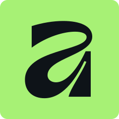
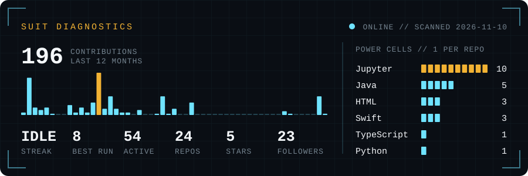

  

  
  
  
  
  
  

  

  Hi, I'm Leon, a designer and developer from Manila. 
  I sketch in Procreate, design in Figma, build in Swift and Java, and train models in Python.

## 🦾 Hall of Armor

Numbered in the order I built them. The gaps are in storage.

| Mark | Suit | What it does | Built with |
| :-: | --- | --- | --- |
| <code>MK&nbsp;XI</code> | **[Payroll Calculator](https://github.com/leonnmarcoo/Employee-Payroll-Calculator)** | Estimates pay as you type and saves drafts to a local database. | React, TypeScript, SQLite |
| <code>MK&nbsp;X</code> | **[Face Mask Detector](https://github.com/leonnmarcoo/CCDEPLRL_COM232_PROJECT)** | Spots masks worn, missing, or worn wrong from a photo or live webcam. | YOLOv8, Streamlit |
| <code>MK&nbsp;IX</code> | **[DeFeed](https://github.com/leonnmarcoo/DeFeed)** | Comic-book iOS app where every scroll heals the villain, Dr. Doomscroll. Then it shows you the years the feed will take. | Swift, SwiftUI |
| <code>MK&nbsp;IV</code> | **[OccuPie](https://github.com/leonnmarcoo/OccuPie)** | Predicts condo prices and occupancy demand, then has an LLM explain the numbers. [See the model.](https://github.com/leonnmarcoo/condo_price_prediction) | Python, scikit&#8209;learn |
| <code>MK&nbsp;II</code> | **[Infinity Quest](https://github.com/leonnmarcoo/Infinity-Quest)** | Rate, review, and track the MCU by phase, release date, or timeline. | JavaFX, MySQL |
| <code>MK&nbsp;I</code> | **[LionBites](https://github.com/leonnmarcoo/LionBites)** | Food ordering app inspired by GrabFood, with customer and admin sides. | JavaFX, MySQL |

<b>Open storage: 5 more suits</b>

 

| Mark | Suit | What it does | Built with |
| :-: | --- | --- | --- |
| <code>MK&nbsp;VIII</code> | **[Movie Clustering](https://github.com/leonnmarcoo/CCADMACL_COM232_PROJECT)** | Groups films with K-Means, hierarchical clustering, and Gaussian mixtures. | scikit&#8209;learn |
| <code>MK&nbsp;VII</code> | **[GratefulMoments](https://github.com/leonnmarcoo/GratefulMoments)** | Gratitude app with streaks and unlockable badges. My first Swift project. | Swift, SwiftUI |
| <code>MK&nbsp;VI</code> | **[Social Media Addiction](https://github.com/leonnmarcoo/CCMACLRL_COM232_PROJECT)** | Pits six classifiers against each other to predict students' addiction scores. | scikit&#8209;learn |
| <code>MK&nbsp;V</code> | **[Disk Scheduling Simulator](https://github.com/leonnmarcoo/Disk-Scheduling-Algorithms-Simulation)** | Animates FCFS, SSTF, SCAN, and C-SCAN so you can watch the disk head move. | JavaFX |
| <code>MK&nbsp;III</code> | **[Circuit Calculator](https://github.com/leonnmarcoo/Series-and-Parallel-Circuit-Calculator)** | Works out series and parallel circuits. | JavaFX |

   
  me, pushing to main on a Friday

## 🧰 The Arsenal

<table align="center">
  <tr>
    <td align="center"><b>Repulsors</b> languages</td>
    <td>
      
      
      
      
      
      
      
    </td>
  </tr>
  <tr>
    <td align="center"><b>J.A.R.V.I.S.</b> data and ML</td>
    <td>
      
      
      
      
      
      
    </td>
  </tr>
  <tr>
    <td align="center"><b>Paint Job</b> design</td>
    <td>
      
      
      
      
      
    </td>
  </tr>
  <tr>
    <td align="center"><b>Workbench</b> tools</td>
    <td>
      
      
      
      
      
    </td>
  </tr>
</table>

   
  me, moving one div two pixels to the left

## 📡 Suit Diagnostics

  
   
  Rebuilt every day by a <a href="https://github.com/leonnmarcoo/leonnmarcoo/blob/main/.github/workflows/snake.yml">GitHub Action</a> in this repo.

   
  me, approving my own pull request

## 🐍 Containment Breach

Something got into the contribution graph.

  <picture>
    <source media="(prefers-color-scheme: dark)" srcset="https://raw.githubusercontent.com/leonnmarcoo/leonnmarcoo/output/github-snake-dark.svg" />
    <source media="(prefers-color-scheme: light)" srcset="https://raw.githubusercontent.com/leonnmarcoo/leonnmarcoo/output/github-snake.svg" />
    
  </picture>

## ✍️ Random Dev Quote

  

---

   
  <b>Sir, I'm gonna have to ask you to exit the README.</b>

